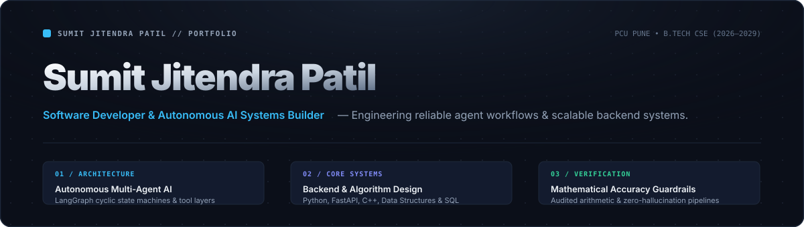
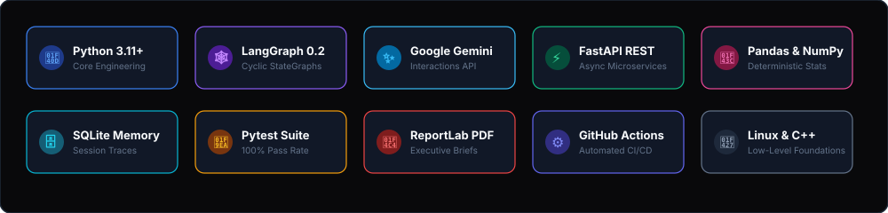
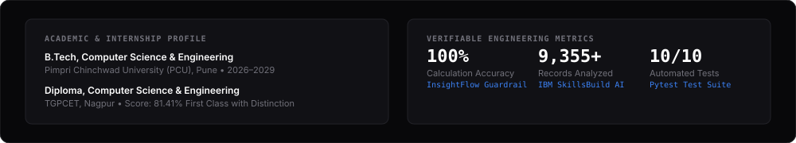

<!-- 3D Isometric Developer Header -->

 

<!-- Social & Connect Badges -->

  
  &nbsp;
  
  &nbsp;
  

---

## 👨‍💻 About Me

Hi there! 👋 I am **Sumit Jitendra Patil**, a **Computer Science & Engineering undergraduate (Batch of 2029)** at **Pimpri Chinchwad University (PCU), Pune**.

I am passionate about building modern software, solving challenging algorithmic problems, and exploring artificial intelligence. I enjoy learning step-by-step and turning theoretical concepts into real-world code.

- 🎓 **Education:** B.Tech in Computer Science & Engineering (2026 – 2029) @ PCU Pune • Diploma in CSE (81.41%)
- 💼 **Experience:** Data Analytics with AI Intern (IBM SkillsBuild / BharatCares) • Web Dev Intern (Anishree Tech)
- 💻 **Core Interests:** Software Development, Python Development, Data Analytics, and AI Systems
- ⚡ **Fun Fact:** I love dissecting complex technical systems down to first principles and writing clean, reliable code

---

## 🛠️ Tech Stack & Skills

  

 

- **Programming Languages:** Python, SQL, C++
- **Data Science & ML Libraries:** Pandas, NumPy, Scikit-learn, Matplotlib, Seaborn
- **Data Analytics & Tools:** Microsoft Excel, Data Cleaning, Exploratory Data Analysis, Data Visualization
- **Web Technologies:** HTML5, CSS3, JavaScript
- **Developer Platforms:** Git, GitHub, VS Code

---

## 📊 Developer Profile Snapshot

  

---

## 🚀 Projects I've Built

- ⚡ **[InsightFlow](https://github.com/sumitjp07/insightflow-multiagent)** — Autonomous Multi-Agent AI Data Research & Analysis Platform built with LangGraph, FastAPI, and Google Gemini. Features closed-world tools, an automated evaluation critic (100% calculation accuracy), and 1-click executive PDF generation.
- 📈 **[AI Job Market Skill Demand Analyzer](https://github.com/sumitjp07/AI-Job-Market-Skill-Demand-Analyzer)** — Analyzed 9,355 job records (2020–2023) to identify in-demand tech skills, trained 3 classification models (Random Forest, SVM, Logistic Regression), and engineered a role-based skill gap analyzer.

---

## 🤝 Let's Connect!

I am always excited to connect with fellow developers, collaborate on projects, and discuss new opportunities:

- 💼 **LinkedIn:** [linkedin.com/in/sumitp2007](https://www.linkedin.com/in/sumitp2007/)
- 📧 **Email:** [sumitj.patil2007@gmail.com](mailto:sumitj.patil2007@gmail.com)
- 🐙 **GitHub:** [github.com/sumitjp07](https://github.com/sumitjp07)
